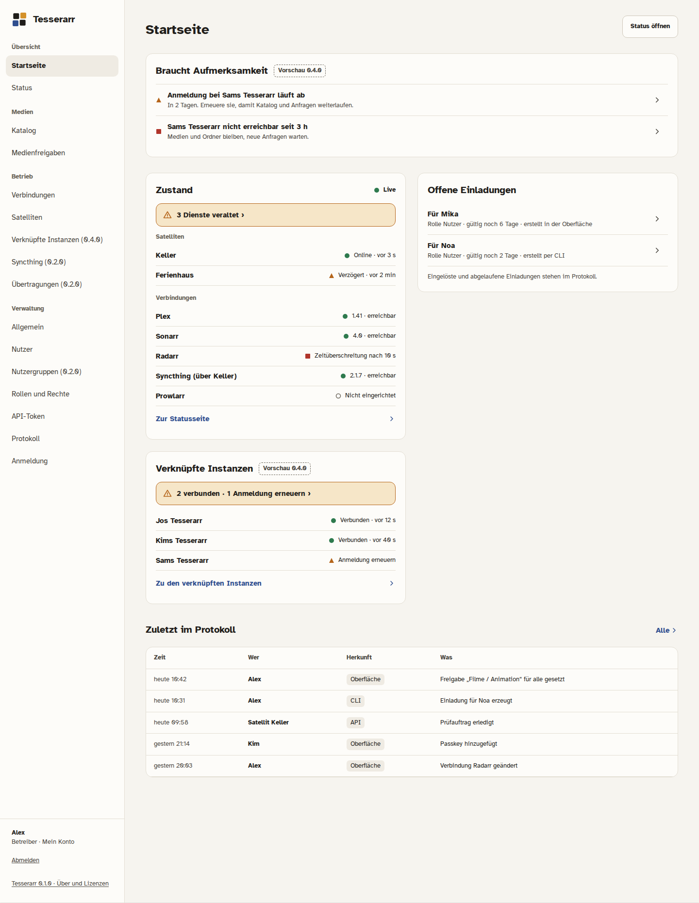
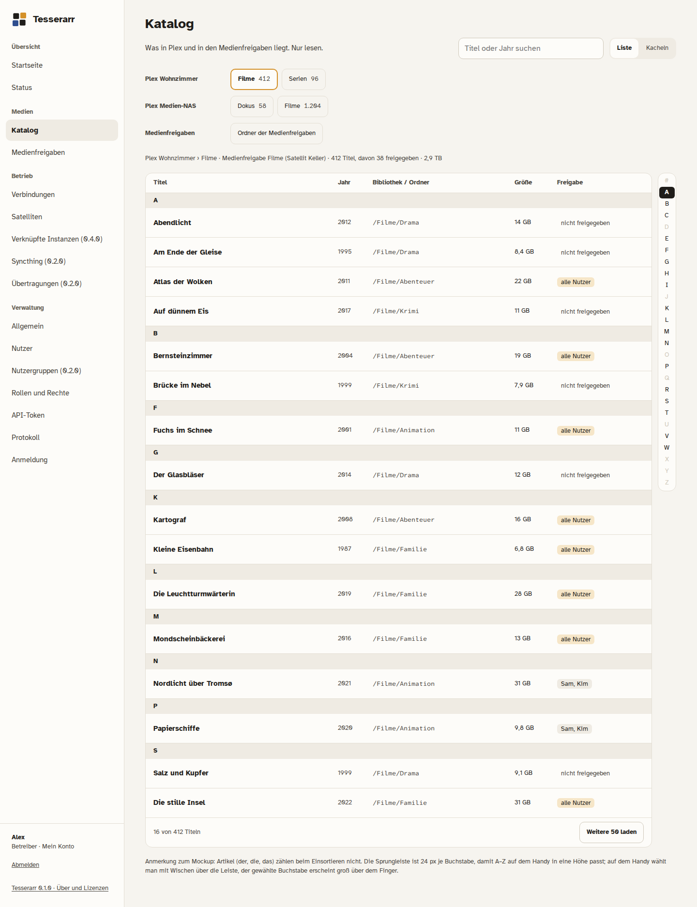
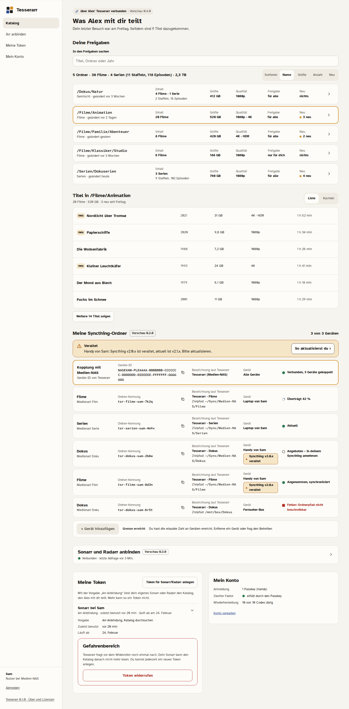
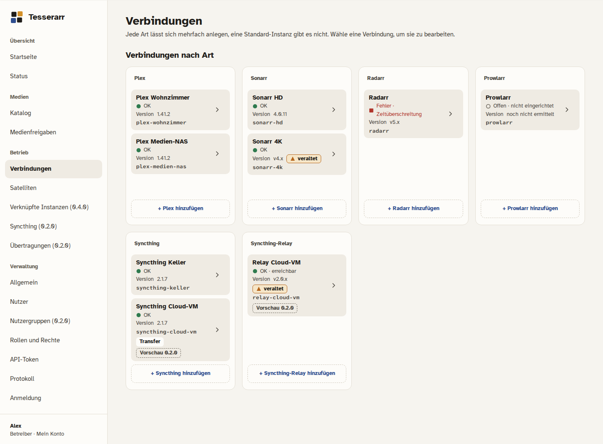
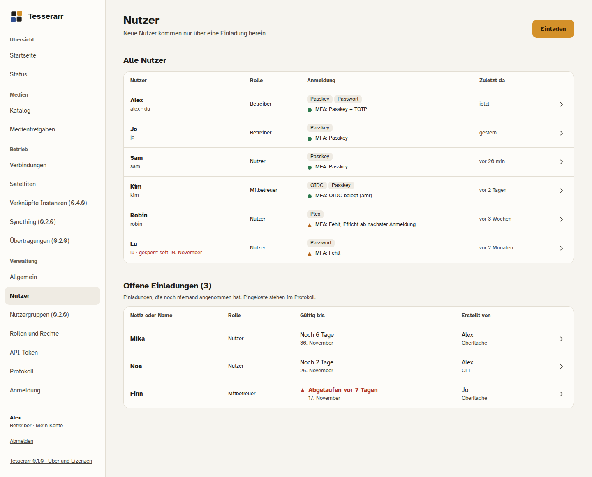
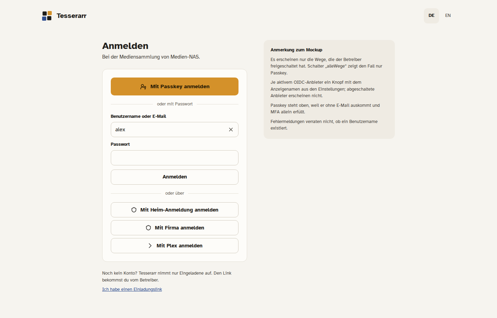
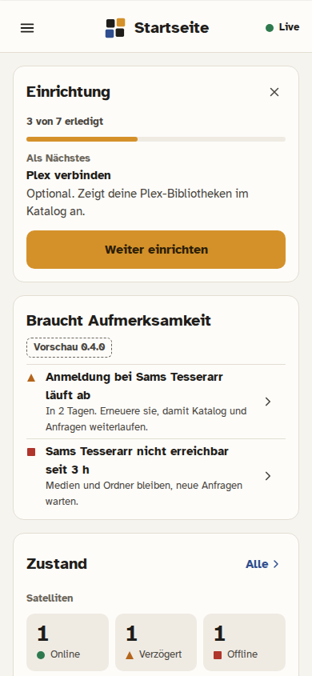
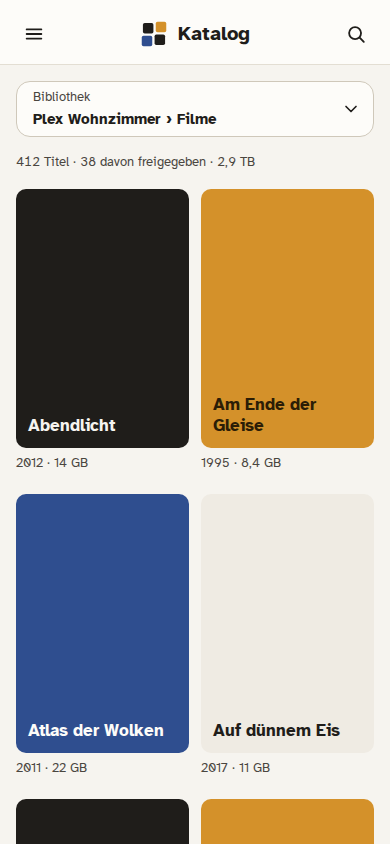

<!--
SPDX-FileCopyrightText: 2026 Björn Strausmann and Tesserarr contributors
SPDX-License-Identifier: AGPL-3.0-or-later
-->

# Tesserarr

**Share parts of your media library with friends over an existing Syncthing link.**

[![CI][b-ci]][l-ci]
[![License: AGPL v3][b-lic]](LICENSE)
[![Conventional Commits][b-cc]][l-cc]
[![semantic-release][b-sr]][l-sr]
[![PHP 8.5][b-php]][l-php]
[![Laravel 13][b-lar]][l-lar]
[![Status: 0.1.0 in progress][b-st]][l-st]
[![Docker Hub][b-dh]][l-dh]

[b-ci]: https://github.com/strausmann/tesserarr/actions/workflows/ci.yml/badge.svg
[l-ci]: https://github.com/strausmann/tesserarr/actions/workflows/ci.yml
[b-lic]: https://img.shields.io/badge/License-AGPL--3.0--or--later-blue.svg
[b-cc]: https://img.shields.io/badge/Conventional%20Commits-1.0.0-yellow.svg
[l-cc]: https://conventionalcommits.org
[b-sr]: https://img.shields.io/badge/%20%20%F0%9F%93%A6%F0%9F%9A%80-semantic--release-e10079.svg
[l-sr]: https://github.com/semantic-release/semantic-release
[b-php]: https://img.shields.io/badge/PHP-8.5-777BB4.svg?logo=php&logoColor=white
[l-php]: https://www.php.net
[b-lar]: https://img.shields.io/badge/Laravel-13-FF2D20.svg?logo=laravel&logoColor=white
[l-lar]: https://laravel.com
[b-st]: https://img.shields.io/badge/status-0.1.0%20in%20progress-orange.svg
[l-st]: https://github.com/strausmann/tesserarr/milestone/1
[b-dh]: https://img.shields.io/badge/Docker%20Hub-bstrausmann%2Ftesserarr-2496ED.svg?logo=docker&logoColor=white
[l-dh]: https://hub.docker.com/r/bstrausmann/tesserarr

Your friends browse the catalogue you chose to share and request a title. They do so either through their own Sonarr
or Radarr, which picks it up as if it came from any other source, or directly in the web interface. The files travel
over Syncthing, without torrents and without a public index. You decide who sees which share, how much they may
request and how long a file stays around if nobody collects it.

Tesserarr is a Laravel 13 application (PHP 8.5) with a Svelte 5 interface and a PostgreSQL 18 database. It ships as
one FrankenPHP-based image.

## Why the name

A *tessera hospitalis* was a small tablet that two befriended Roman households broke in half, each keeping one piece.
Presenting the matching half proved the bond of guest-friendship, sometimes generations later. Two homelabs, one
invitation, a private tie.

The `-arr` suffix places the project in the family around Sonarr, Radarr and Prowlarr. It is a genre marker, not a
dependency: Tesserarr works fine without any of them.

## How it works

```
FRIEND                             YOU
Prowlarr  ── search ──────────▶  indexer
Sonarr    ── grab ────────────▶  download client
          ◀─ progress, done ──      │
                                    ▼
                            hardlink into outgoing/
                                    │
                              Syncthing carries it
                                    │
income/ ◀───────────────────────────┘
Sonarr imports and renames
        │
deletes it ──────────────────▶  transfer counts as collected
```

Progress is measured, not guessed: Tesserarr reads it from its own Syncthing instance, per device and folder.

- **One centre, optional satellites.** The central instance holds the database, the interface and the rules.
  Satellites run on other machines, for example next to the media storage. They have no database: they pull jobs from
  the centre and create the hardlinks on the host that holds the media.
- **Hardlinks first.** When several people receive the same title, Tesserarr hardlinks it instead of copying it, so it
  occupies the disk once. A copy is the fallback when source and target sit on different file systems.
- **Transfer instance.** An optional Syncthing on a cloud VM receives each title once and serves it from there, so you
  need not open your own Syncthing to your friends. An own relay is the alternative.
- **Import signal.** Sonarr and Radarr report an import by removing the download from the download client's history
  ("Remove Completed"). Tesserarr treats that as the signal that the transfer was collected.
- **Instance coupling (from 0.4.0).** A friend who runs Tesserarr too links their instance to yours. It finds yours
  through discovery, signs in at yours and sets up the Syncthing link on both sides.

## Features

Each item says in which release it arrives.

**Accounts and sign-in**

- Invitation-only accounts with atomic redemption (0.1.0)
- Password, passkeys and TOTP, with mandatory MFA for administrative rights (0.1.0)
- OIDC with several providers in parallel, Plex sign-in and forward-auth header sign-in (0.1.0)
- Confirmation of security-relevant changes with a fresh second factor (0.1.0)
- Optional email over SMTP or JMAP, with PGP per recipient; addresses are stored encrypted (0.1.0)
- User groups, each with its own connection paths: direct, over a relay or over the transfer instance (0.2.0)

**Shares and catalogue**

- Media shares with fail-closed path resolution and grant rules per user (0.1.0)
- Browse, search and bulk actions over an incremental folder index (0.1.0)
- Friend view with the list of shares and key figures (0.1.0)
- Request from the catalogue with quotas per media type and a soft limit (0.3.0)
- Warning system for conspicuous behaviour, in escalating steps (0.3.0)

**Syncthing delivery**

- Syncthing management over its REST API: status, connection settings, bandwidth limits and ignore patterns (0.2.0)
- Managed folders and devices per user, transfer history and views (0.2.0)
- Delivery and pickup detection, grace period and clean-up (0.2.0)
- Hardlink provisioning through satellites, with a copy fallback (0.2.0)
- Transfer instance and optional own Syncthing relay (0.2.0)

**Arr integration**

- Read access to Sonarr, Radarr, Prowlarr, Syncthing and Plex connections (0.1.0)
- Version check for all connections, with a notice when one is outdated (0.2.0)
- Emulated Newznab indexer and SABnzbd download client for your friends' own arr apps, with the import feedback (0.3.0)
- Instance coupling with discovery and sign-in at the friend's instance (0.4.0)

**Operation**

- Setup checklist with a guided wizard and settings in the interface (0.1.0)
- Migrations that write a database backup first, shown on the status page (0.1.0)
- Append-only audit log and live status updates (0.1.0)
- Interactive API documentation with Scalar for signed-in users (0.1.0)
- Octane worker mode on FrankenPHP (0.2.0)
- Notification centre with mail, Teams, Discord and Telegram (0.2.0)

## Preview (mockups)

These are drafts. They are replaced by real screenshots as soon as the interface exists.

### Dashboard

<!--  -->

Mockups follow.

### Catalog

<!--  -->

Mockups follow.

### Friend home

<!--  -->

Mockups follow.

### Connections

<!--  -->

Mockups follow.

### Users

<!--  -->

Mockups follow.

### Sign-in

<!--  -->

Mockups follow.

### On a phone

<!--  -->
<!--  -->

Mockups follow.

## Roadmap

Each release is a GitHub milestone and ships when all its issues are closed.

**[0.1.0](https://github.com/strausmann/tesserarr/milestone/1): foundation**

- Accounts, sign-in methods, roles and the audit log
- Invitations, setup wizard and settings in the interface
- Media shares, grant rules and the catalogue
- Satellite skeleton with pull-based read-only jobs
- Connections to Sonarr, Radarr, Prowlarr, Syncthing and Plex
- Migrations with backup, status page and interactive API documentation

**[0.2.0](https://github.com/strausmann/tesserarr/milestone/2): first media path**

- Hardlink provisioning through satellites, with a copy fallback
- Managed Syncthing folders and devices, pickup detection and clean-up
- Transfer instance, own relay, user groups and connection paths
- Version check for all connections
- Notification centre with mail, Teams, Discord and Telegram
- Octane worker mode

**[0.3.0](https://github.com/strausmann/tesserarr/milestone/3): arr integration**

- Newznab and SABnzbd emulation for your friends' own arr apps
- Requests straight from the catalogue
- Quotas per media type with a soft limit
- Warning system for conspicuous behaviour

**[0.4.0](https://github.com/strausmann/tesserarr/milestone/4): recipient instance**

- Instance coupling with discovery and sign-in at the friend's instance
- Automatic Syncthing pairing on both sides
- Self-registration in Sonarr, Radarr and Prowlarr
- Setup wizard, request dialog and import feedback

**Later:** [0.5.0](https://github.com/strausmann/tesserarr/milestone/5) adds Jellyfin and Emby support and an
ignore-list mode. [1.0.0](https://github.com/strausmann/tesserarr/milestone/6) brings operation with real participants,
an upgrade path and an API stability commitment.

## Tech Stack

- **Backend:** PHP 8.5, Laravel 13, PostgreSQL 18
- **Runtime:** FrankenPHP on Debian 13 (trixie), with Octane from 0.2.0
- **Interface:** Svelte 5 with Inertia 3, Vite, Tailwind v4
- **Live updates:** Reverb
- **Quality:** Pest, Larastan, Pint, Vitest, Playwright
- **API documentation:** Scramble (OpenAPI) and Scalar
- **Dependencies:** Renovate
- **Supply chain:** cosign v3 signatures and an SBOM on every image

## Container images and tags

Images are published to `docker.io/bstrausmann/tesserarr` as multi-arch builds (`linux/amd64`, `linux/arm64`). The
GitHub Container Registry copy is private.

| Tag          | Example             | Use when                                                        |
| ------------ | ------------------- | --------------------------------------------------------------- |
| `x.y.z`      | `0.1.0`             | You want full reproducibility                                   |
| `x.y`        | `0.1`               | Get bug fixes automatically                                     |
| `x`          | `1`                 | Stay on a major version, get features                           |
| `latest`     | most recent release | You are fine with anything new                                  |
| `dev`        | built from `main`   | Testing only; changes with every merge                          |
| `x.y.z-rc.N` | `0.1.0-rc.1`        | Preview of an upcoming release; removed once the release exists |

Previews never get `latest`, `x.y` or `x`, so a preview can never become the default.

Every image is signed without a key (Sigstore cosign, GitHub OIDC) and carries an SBOM and a build provenance
attestation. Verifying needs **cosign v3 or newer**. Without a local installation, run cosign in a container:

```bash
docker run --rm ghcr.io/sigstore/cosign/cosign:v3.0.2 verify docker.io/bstrausmann/tesserarr:0.1.0-rc.1 \
  --certificate-identity-regexp 'https://github.com/strausmann/tesserarr/.*' \
  --certificate-oidc-issuer https://token.actions.githubusercontent.com
```

## Quick Start

Available with 0.1.0.

## API

Signed-in users find the interactive API documentation, rendered with Scalar, at `/docs/api`. The reference is also on
the documentation website. Both are generated from the code by Scramble, so they cannot drift from the routes.

## Requirements

Planned for the first release:

- Docker with Compose
- PostgreSQL 18 (included in the Compose file)
- A Syncthing instance that Tesserarr may control
- Optional: Sonarr, Radarr, Prowlarr and Plex

## Documentation

Setup, operations and the full picture of how Syncthing, Prowlarr, Sonarr, Radarr and your media server fit together
will live on the project's documentation website.

## Contributing

Contributions are welcome. See [CONTRIBUTING.md](CONTRIBUTING.md) for the workflow. Contributions need a signed
[Contributor License Agreement](CLA.md).

## Security

Please report vulnerabilities privately, as described in [SECURITY.md](SECURITY.md).

## License

Tesserarr is licensed under the GNU Affero General Public License v3.0 or later (AGPL-3.0-or-later), see
[LICENSE](LICENSE). The JMAP client in `packages/laravel-jmap-client/` (`strausmann/laravel-jmap-client`) is licensed
under MIT.
